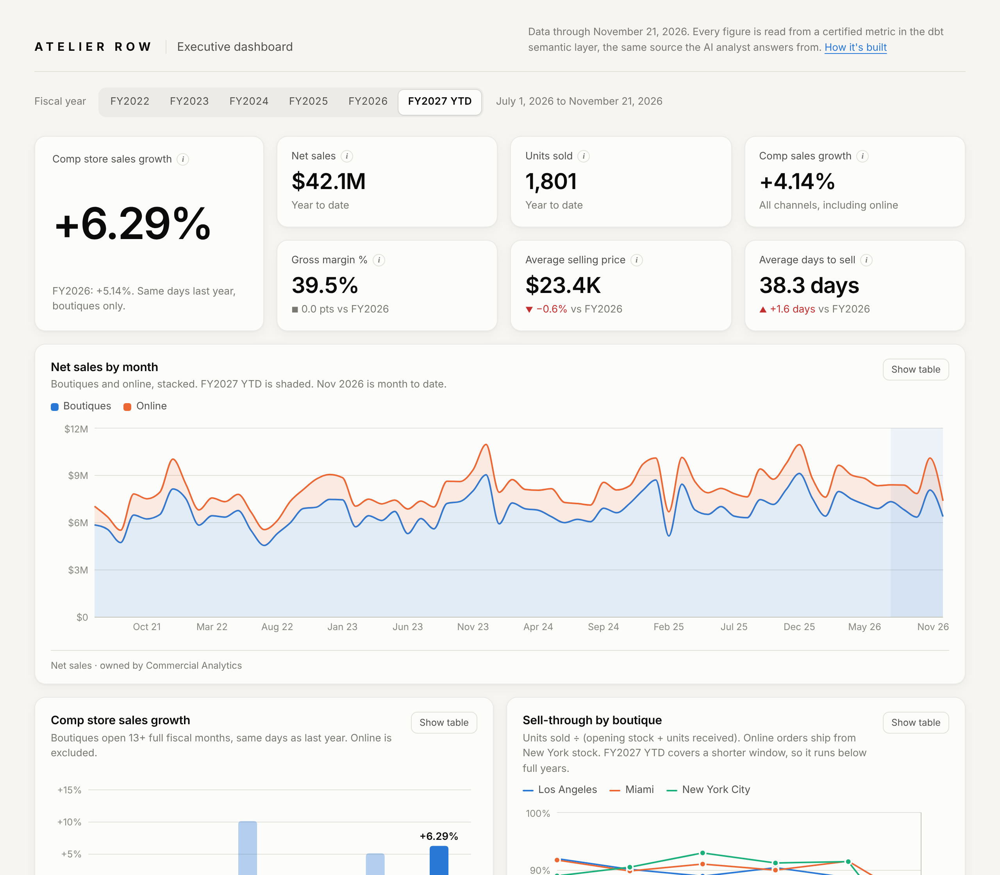

# Atelier Row analytics

[](https://github.com/keithgilb1/atelier-row-analytics/actions/workflows/atelier-analytics.yml)

My work has been about one problem: making sure a number means the same thing wherever it shows up. I've done that through Power BI governance at Nike, through comparable-store metrics, and through outlier checks that catch bad data before it reaches a dashboard. More recently I've been doing it with AI agents that answer questions from governed data instead of guessing.

This repo shows that work end to end, on data you can rebuild yourself in under a minute.

## What's here

Atelier Row is a fictional resale retailer of luxury handbags, with three boutiques and an online channel. This repo models it from raw extracts to an AI analyst:

- **dbt + DuckDB pipeline.** Staging, intermediate and marts layers, with enforced contracts on every public column, reconciliation and inventory roll-forward tests, a PII scan, and unit tests for the comp-store rule.
- **Governed metrics layer.** Comp store sales growth, sell-through, aged inventory, margin and more, each defined once in MetricFlow with an owner.
- **Two consumers, one number.** The dashboard export and the AI agent are tested on every PR to return identical results. An independent pandas re-implementation confirms the definitions are right.
- **AI analyst agent.** It answers questions through certified metrics first and falls back to guarded, read-only SQL. Every answer is logged with the SQL behind it, and the agent is scored against an answer key that includes trap questions.
- **Pricing outlier audit.** A robust z-score screen flags sales priced far from comparable pieces.
- **React dashboard.** An executive dashboard (React, Vite, Recharts) that reads only the governed saved queries. CI fails if its bundled data drifts from the semantic layer.
- **CI.** GitHub Actions rebuilds and tests everything on each pull request.

The governed comp figure for FY2027 to date is **+6.29%**. A reasonable-looking hand-written query on the same warehouse says **−60%**. [Here's why](atelier_analytics/README.md#proof-that-two-consumers-get-the-same-number).

| Folder | What it is |
|---|---|
| [`generator`](generator/README.md) | Seed-deterministic generator for the warehouse: buy-ins, a four-stage authentication pipeline, daily stock and sales |
| [`atelier_analytics`](atelier_analytics/README.md) | The dbt project, semantic layer, parity tests and AI agent. **Start here** |
| [`dashboard`](dashboard/README.md) | The executive dashboard: React + Vite + Recharts, built from the governed metrics |



## Quickstart

You need **Python 3.12 or newer** and `make`. No cloud accounts are needed. The agent needs Claude API access; everything else runs offline.

Check your version with `python3 --version`. On a Mac, the built-in Python is too old, so install a newer one with [Homebrew](https://brew.sh): `brew install python@3.12`.

```bash
git clone https://github.com/keithgilb1/atelier-row-analytics.git
cd atelier-row-analytics
make setup    # one time: creates atelier_analytics/.venv and installs the pinned packages
make all      # generates the data, builds and tests everything (about 30 seconds)
```

`make setup` uses the newest `python3.x` it finds. To pick one, run `make setup PYTHON=python3.12`.

Every `make` target uses the virtual environment automatically, so you don't need to activate it. To run `dbt` or `mf` commands yourself, activate it once in each new terminal:

```bash
source atelier_analytics/.venv/bin/activate
cd atelier_analytics
dbt docs generate --profiles-dir . && dbt docs serve --profiles-dir .
```

### Open the dashboard

The dashboard needs **Node.js 20 or newer**. On a Mac: `brew install node`. Then, from the repo root:

```bash
make dashboard        # installs the packages the first time, then opens http://localhost:5173
```

It ships with its data already bundled, so it runs without the Python steps. After `make all` the data is refreshed for you; to refresh it on its own, run `make dashboard-data`. `make dashboard-build` writes a static site to `dashboard/dist` that any web host can serve. More in [dashboard/README.md](dashboard/README.md).

### Ask the agent

To ask the agent a question, sign in to the Claude API (`ant auth login`, or set `ANTHROPIC_API_KEY`), then run `make ask Q="How are comps tracking this year?"`.

More of my work, including a synthetic SaaS warehouse built for testing analytics agents, is in [keithgilb1/quillstack](https://github.com/keithgilb1/quillstack).
