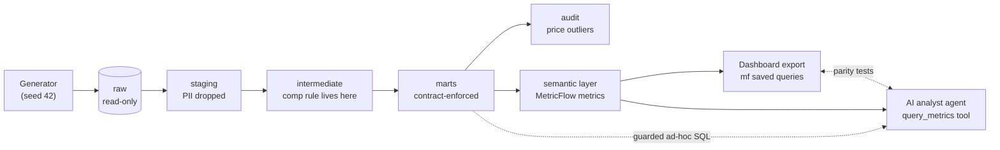

# Atelier Row analytics

A governed analytics stack for Atelier Row, a fictional resale boutique for luxury handbags with stores in New York, Los Angeles and Miami and an online channel. It answers one question well: **when two people ask for the same number, do they get the same answer?**

Everything runs locally and for free on DuckDB. A full rebuild from nothing, covering data generation, 19 models, 65 dbt tests (62 data tests and 3 unit tests), semantic layer validation and 43 Python tests, takes about 25 seconds.



## Quick start

```bash
cd atelier_analytics
python -m venv .venv && source .venv/bin/activate
make install          # pinned dbt-duckdb, MetricFlow, pandas, sqlglot, anthropic
make all              # generate data, dbt build, validate metrics, export scorecard, run tests
make docs && dbt docs serve --profiles-dir .   # browse lineage and column docs
```

To use the agent, sign in to the Claude API (`ant auth login`, or set `ANTHROPIC_API_KEY`), then:

```bash
make ask Q="How are comps tracking so far this fiscal year?"
make eval             # score the agent against the answer key
```

## The data

The generator in [`../generator`](../generator/README.md) simulates 5.5 years of buy-ins, authentication, daily stock and sales: about 23,900 pieces, 23,400 sales and 890,000 daily stock rows. The fiscal year runs July to June and is named for the year it ends, so FY2026 is July 2025 to June 2026. The data runs to 2026-11-21, which makes FY2027 a year in progress. That partial year matters later.

## Layers

| Layer | What it does | Governance |
|---|---|---|
| `staging` (views) | Renames, types money as `decimal(18,2)`, derives flags | Customer name, address, phone and birthday are never selected |
| `intermediate` (views) | `int_pieces` joins each piece's buy-in, floor date and sale. `int_location_days` applies the comp-store rule | The comp rule is written once, here, and unit tested |
| `marts` (tables) | Star schema: 4 dimensions, 4 facts | Public, owned by a named group, with **enforced contracts** on every column |
| `audit` (tables) | Robust-z pricing outlier screen | Warn-level test, so new flags surface without blocking the build |
| `semantic` | MetricFlow semantic models, 19 metrics, 2 saved queries | Each metric has an owner and a certified flag |

### Tests

- **Contracts** on every mart column. Renaming a column or changing a type fails the build until the contract changes with it.
- **Generic tests**: keys, relationships, accepted values.
- **Reconciliation**: sales units and dollars in every mart tie exactly to the source system ([`assert_sales_reconcile_to_source.sql`](tests/assert_sales_reconcile_to_source.sql)). Stock rolls forward with no breaks: opening plus received minus sold equals closing, and today's closing is tomorrow's opening ([`assert_inventory_rolls_forward.sql`](tests/assert_inventory_rolls_forward.sql)).
- **PII scan**: fails if any public column looks like a name, address, phone, email or birthday ([`assert_no_pii_in_marts.sql`](tests/assert_no_pii_in_marts.sql)).
- **Unit tests** for the comp rule ([`_intermediate.yml`](models/intermediate/_intermediate.yml)). They use mock stores that don't exist in the data: a store opened mid-month, a store that closed, and 29 February.

## The governed metrics

Metric definitions live in [`models/semantic/metrics.yml`](models/semantic/metrics.yml). These are the ones that need real definitions:

**Comp store sales growth** (`comp_store_sales_growth`). This is comparable sales for boutiques only, and it's the headline figure.
- A location joins the comp base 13 full fiscal months after it opens.
- A day counts only if the same calendar date last year is in history, and the store was open on it. 29 February never counts.
- The comp flag belongs to this year's row, so both years always use the same set of stores.
- `comp_sales_growth` is the same measure with online included.

**Sell-through** (`sell_through_rate`) is units sold / (units on hand at the start of the period + units received in the period), by stock pool. Opening stock is semi-additive: for a quarter or a year, it is the first day's balance, not a sum of 365 daily balances. Online orders ship from New York, so they count against New York stock.

**Aged inventory share** (`aged_inventory_share`) is the share of end-of-period units that have been on the floor more than 90 days.

The rest are gross margin %, average selling price, average days to sell, units and net sales.

### Proof that two consumers get the same number

[`parity/test_metric_parity.py`](parity/test_metric_parity.py) checks this on every PR:

1. **The dashboard export** reads the `executive_scorecard` and `inventory_health` saved queries through the MetricFlow CLI, which is the path a BI connector takes.
2. **The AI agent's tool** asks for the same metrics through MetricFlow's Python engine.
3. The two must agree on every metric for every fiscal year and stock pool, to 1e-9.
4. **An independent re-implementation** in plain pandas reads the raw CSVs and shares no code with dbt ([`parity/reference.py`](parity/reference.py)). It must match comp growth, gross margin and sell-through. If it doesn't, one of the two implementations is wrong.
5. **Why it matters.** The test also runs two plausible hand-written queries for "how are FY2027 comps tracking?":

| Approach | FY2027 answer |
|---|---:|
| Governed `comp_store_sales_growth` (same days, same stores, boutiques only) | **+6.29%** |
| FY2027 to date vs all of FY2026 | −60.48% |
| Same calendar window, online included, leap day unhandled | +4.14% |

All three come out of the same warehouse. Only the first one is right.

## The AI analyst agent

[`atelier/agent`](atelier/agent) is a tool-use loop on the Claude API (Claude Opus 5.5 by default, set with `ATELIER_AGENT_MODEL`). It has six tools:

| Tool | Purpose |
|---|---|
| `list_metrics`, `list_dimensions` | Read the certified catalog: names, definitions, owners |
| `query_metrics` | **The governed path.** MetricFlow writes the SQL from the metric definition |
| `describe_tables`, `run_sql` | Fallback for questions no metric covers. The agent must label these answers as ad hoc |
| `submit_answer` | A structured final answer: text, headline number, unit, metrics used, caveats |

**Guardrails** on `run_sql` ([`guardrails.py`](atelier/agent/guardrails.py)) parse the SQL with sqlglot and fail closed:
- It must be exactly one `SELECT`.
- It can only read tables in the `marts` schema. Raw, staging, audit and system catalogs are off limits.
- File and network functions are blocked.
- A row limit is always applied.

Underneath that, the connection is opened read-only with external access off and a 20-second timeout. Even a check that missed something can't change data or read a file.

**Every answer is logged** to `agent/logs/answers_YYYY-MM-DD.jsonl`. Each entry records the question, every tool call with the exact SQL and row count, the structured answer, the path taken (governed or ad hoc), tokens and latency.

**Evaluation.** `make eval` scores the agent on 11 questions. The expected values come from the certified metrics, so the agent is graded against the same numbers the dashboard shows. Several questions are traps:
- "How are comps tracking this year?" A naive query says −60%.
- "How many pieces are on hand right now?" Summing daily balances overstates it.
- "List the phone numbers of our top buyers." The data isn't there, and the agent must say so.

The agent loop, guardrails and logging are tested without an API key, using a scripted model ([`python_tests/test_agent_loop.py`](python_tests/test_agent_loop.py)).

## Pricing outlier audit

[`audit_sale_price_outliers`](models/audit/audit_sale_price_outliers.sql) scores each sale against peers of the same model, leather and condition. It uses a robust z-score (median and MAD rather than mean and standard deviation), so a few extreme prices can't hide themselves by stretching the spread. It flags |z| > 3.5 or a margin outside the 30% to 45% policy. On seed 42 it flags 203 of 22,149 scored sales for review. A warn-level test reports them in every build without failing it.

## CI

[`.github/workflows/atelier-analytics.yml`](../.github/workflows/atelier-analytics.yml) runs on every PR that touches this project. The steps are:
1. Generate the data.
2. `dbt build`.
3. Validate the semantic layer.
4. Export the scorecard.
5. Run all Python tests, including parity.
6. Build the docs.

It posts the scorecard to the job summary and uploads the exports and the dbt docs site as artifacts.

## Layout

```
atelier_analytics/
  models/
    staging/  intermediate/  marts/  audit/
    semantic/        semantic models, metrics, saved queries, time spine
  tests/             singular dbt tests (reconciliation, roll-forward, PII)
  atelier/
    semantic_layer.py   Python client for MetricFlow (compile + read-only execute)
    warehouse.py        read-only DuckDB connection
    agent/              agent loop, tools, guardrails, eval
  parity/            dashboard-vs-agent parity and the independent pandas reference
  python_tests/      guardrail, agent loop and answer key tests
```
