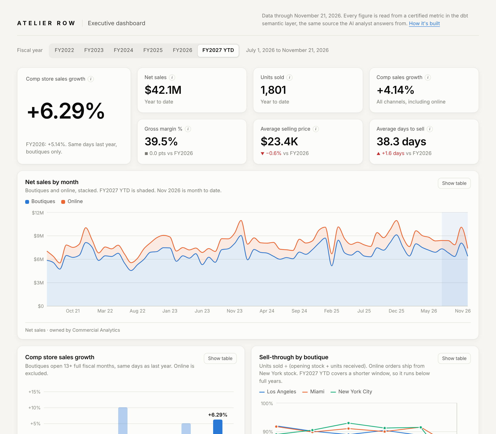

# Atelier Row executive dashboard

A React dashboard for the Atelier Row warehouse: comp store sales growth, monthly sales by channel, sell-through and aged stock by boutique, and the sales mix by model. Pick a fiscal year and every tile, chart and table updates together.



**It does no metric math of its own.** Every number comes from a MetricFlow saved query in [`atelier_analytics/models/semantic/saved_queries.yml`](../atelier_analytics/models/semantic/saved_queries.yml), the same governed definitions the AI agent and the parity tests use. The page shows each metric's definition and owner, pulled from the semantic manifest, so a reader can see exactly what a number means. CI rebuilds the data on every pull request and fails if the copy bundled here no longer matches.

## Run it

You need Node.js 20 or newer. On a Mac, install it with [Homebrew](https://brew.sh):

```bash
brew install node
node --version    # v20 or newer
```

From the repo root:

```bash
make dashboard
```

The first run installs the packages (about 30 seconds). Then open http://localhost:5173. Edits to files in `src/` show up in the browser as soon as you save. Stop the server with Ctrl+C.

The same thing without `make`:

```bash
cd dashboard
npm ci          # install the exact package versions in package-lock.json
npm run dev     # start the development server
```

## Refresh the data

The data lives in `src/data/atelier.json` and is committed, so the dashboard runs without Python. To regenerate it from the warehouse (after `make setup` and `make all`, or after changing a metric):

```bash
make dashboard-data
```

That runs the saved queries with `mf query --saved-query ...`, then [`atelier/dashboard_export.py`](../atelier_analytics/atelier/dashboard_export.py) packs the CSVs and the metric definitions into one JSON file. The output is deterministic, so if nothing changed in the pipeline, git shows no diff. `make all` runs this step too.

| Saved query | What it feeds |
|---|---|
| `executive_scorecard` | The headline tiles and the comp growth chart |
| `inventory_health` | Sell-through by boutique and the inventory table |
| `sales_trend` | Net sales by month, boutiques and online |
| `category_mix` | Net sales by model |

## Build a static site

```bash
make dashboard-build      # or: cd dashboard && npm run build
```

This writes plain HTML, CSS and JavaScript to `dashboard/dist`. It uses relative paths, so it works from any folder or host: GitHub Pages, Netlify, Vercel, or an S3 bucket. `npm run preview` serves the build locally to check it.

## How the code is laid out

If you're coming from Power BI or Tableau, a React app is a set of components, each a function that takes some inputs and returns what to draw. When an input changes (here, the selected fiscal year), React redraws whatever depends on it.

| File | What it does |
|---|---|
| `src/main.tsx` | Entry point. Mounts the app into `index.html` |
| `src/App.tsx` | The page: header, fiscal year picker, KPI tiles and the chart grid. Holds the selected year in state |
| `src/data.ts` | Loads `atelier.json` and gives each dataset a TypeScript type. Fiscal year helpers live here |
| `src/components/Charts.tsx` | The four Recharts charts |
| `src/components/ChartCard.tsx` | The card around each chart, with the Show table toggle and the metric owner footer |
| `src/components/StatTile.tsx` | A KPI tile with its change vs last year and a definition popover |
| `src/components/InventoryTable.tsx` | Inventory health by boutique |
| `src/components/MetricGlossary.tsx` | The metric definitions at the bottom of the page |
| `src/format.ts` | Number, currency and date formatting |
| `src/theme.ts`, `src/index.css` | Colors and layout, in light and dark mode |

Useful commands, run inside `dashboard/`:

| Command | What it does |
|---|---|
| `npm run dev` | Development server with live reload |
| `npm run build` | Type-check, then build the static site into `dist/` |
| `npm run lint` | Lint with oxlint |
| `npm run preview` | Serve the built site locally |

## Design notes

- **Year-to-date is labeled, not compared to full years.** FY2027 runs from July 1 to the last day of data, so additive figures (net sales, units) show "Year to date" instead of a misleading change against a full year. Rates such as margin and days to sell still show their change. The first fiscal year has one month of history and is left out of the picker.
- **Colors follow the entity.** Each boutique and channel keeps its color on every chart. The three boutique colors are a colorblind-safe set, checked in both light and dark mode, and every chart has a table view, so color is never the only way to read a value.
- **Comp growth uses one color per direction.** Growth is blue, decline is red, and the selected year is drawn at full strength.
